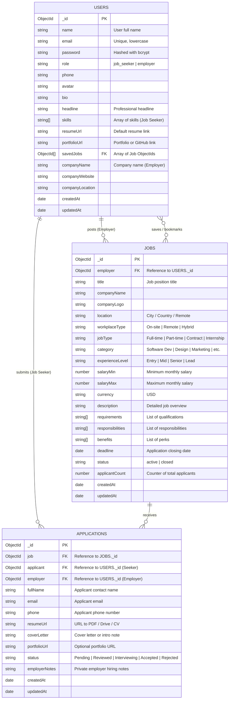

# 💼 CareerHub — Full-Stack Job Portal Web Application

> **Final Project — Full-Stack Web Development**  
> **Course Code:** `#FSD001_26`  
> **Score Weight:** `40%`  
> **Student Name:** `Virak Yuth`  
> **Folder:** `Virak_yuth_final_#FSD001_26`

---

## 🌟 Executive Summary

**CareerHub** is a production-ready, full-stack Job Portal web application developed using the MERN stack (**MongoDB Atlas, Express.js, React.js, Node.js**) powered by **Vite** and styled with **Tailwind CSS**. 

The platform supports two distinct user roles:
1. **Job Seekers:** Browse vetted job openings, filter by multiple criteria, submit detailed applications with resume and cover letter, track application status in real-time, and bookmark favorite jobs.
2. **Employers:** Publish new job postings, manage existing listings, review candidate applications, inspect resumes and portfolios, update candidate hiring stages (*Pending*, *Reviewed*, *Interviewing*, *Accepted*, *Rejected*), and record private hiring notes.

---

## 🚀 Technologies Used

| Domain | Technology | Description |
|---|---|---|
| **Frontend** | `React.js (v18)` | Component-driven user interface |
| **Build Tool** | `Vite` | Ultra-fast next-generation frontend tooling |
| **Styling** | `Tailwind CSS` | Utility-first, modern responsive UI styling |
| **Routing** | `React Router DOM (v6)` | Client-side routing with Role-based Protected Routes |
| **Icons & UI** | `Lucide React` + `React Hot Toast` | Sleek icon set and modern notification toasts |
| **HTTP Client** | `Axios` | HTTP library configured with JWT request interceptors |
| **Backend** | `Node.js` + `Express.js` | RESTful API server with modular controllers & routes |
| **Authentication** | `JSON Web Tokens (JWT)` + `Bcrypt.js` | Secure stateless auth & salted password hashing |
| **Database** | `MongoDB Atlas` + `Mongoose` | Scalable NoSQL cloud database with schema validation & indexing |
| **Deployment** | `Vercel` | Serverless backend API & global edge static frontend |

---

## 📐 Project Structure

```text
Virak_yuth_final_#FSD001_26/
├── client/                     # Frontend (React + Vite + Tailwind CSS)
│   ├── public/                 # Static assets
│   ├── src/
│   │   ├── api/
│   │   │   └── axios.js        # Configured Axios instance with JWT interceptor
│   │   ├── components/
│   │   │   ├── ApplyModal.jsx  # Job application modal dialog
│   │   │   ├── Footer.jsx      # Application footer with student metadata
│   │   │   ├── JobCard.jsx     # Reusable job card with bookmarking
│   │   │   ├── JobFilter.jsx   # Multi-attribute filter sidebar
│   │   │   ├── LoadingSpinner.jsx
│   │   │   ├── Navbar.jsx      # Role-aware responsive navigation bar
│   │   │   └── ProtectedRoute.jsx # Role-based route guard
│   │   ├── context/
│   │   │   └── AuthContext.jsx # Global auth state & 1-click demo login
│   │   ├── pages/
│   │   │   ├── EditJobPage.jsx
│   │   │   ├── EmployerDashboard.jsx
│   │   │   ├── HomePage.jsx
│   │   │   ├── JobApplicantsPage.jsx
│   │   │   ├── JobDetailPage.jsx
│   │   │   ├── JobsPage.jsx
│   │   │   ├── LoginPage.jsx
│   │   │   ├── NotFoundPage.jsx
│   │   │   ├── PostJobPage.jsx
│   │   │   ├── ProfilePage.jsx
│   │   │   ├── RegisterPage.jsx
│   │   │   ├── SavedJobsPage.jsx
│   │   │   └── SeekerDashboard.jsx
│   │   ├── App.jsx             # Route definitions & Toaster provider
│   │   ├── index.css           # Tailwind base, components, utilities
│   │   └── main.jsx            # React root mount
│   ├── .env                    # Frontend environment variables
│   ├── .env.example
│   ├── index.html
│   ├── package.json
│   ├── postcss.config.js
│   ├── tailwind.config.js
│   ├── vercel.json             # Vercel SPA routing rewrite config
│   └── vite.config.js
│
├── server/                     # Backend API (Node.js + Express + Mongoose)
│   ├── api/
│   │   └── index.js            # Vercel serverless function entry point
│   ├── config/
│   │   └── db.js               # MongoDB connection with connection caching
│   ├── controllers/
│   │   ├── applicationController.js
│   │   ├── authController.js
│   │   ├── jobController.js
│   │   └── userController.js
│   ├── middleware/
│   │   ├── authMiddleware.js   # JWT protect & role authorize middleware
│   │   └── errorMiddleware.js  # Global 404 & error handlers
│   ├── models/
│   │   ├── Application.js      # Application Mongoose schema
│   │   ├── Job.js              # Job posting Mongoose schema
│   │   └── User.js             # User & credentials Mongoose schema
│   ├── routes/
│   │   ├── applicationRoutes.js
│   │   ├── authRoutes.js
│   │   ├── jobRoutes.js
│   │   └── userRoutes.js
│   ├── .env                    # Backend environment variables
│   ├── .env.example
│   ├── index.js                # Main Express server entry point
│   ├── package.json
│   ├── seed.js                 # Automated seed script with realistic demo data
│   └── vercel.json             # Vercel backend serverless routing config
│
├── .gitignore
├── package.json                # Root package for workspace orchestration
└── README.md                   # Full documentation & presentation guide
```

---

## 🗄️ Database Design (Table / Schema Design)

*(Use this section and the diagram below for **Final Submission Item #2: Database — screenshot table design**)*

### 1. Entity-Relationship Diagram (ERD)



### 2. Detailed Collection Schemas

#### A. `users` Collection
- **`_id`**: `ObjectId` (Primary Key, Auto-generated)
- **`name`**: `String` (Required, trim, max 50 chars)
- **`email`**: `String` (Required, unique index, lowercase, validated regex)
- **`password`**: `String` (Required, min 6 chars, hashed via bcrypt salt 10, excluded from standard queries via `select: false`)
- **`role`**: `String` (Enum: `['job_seeker', 'employer']`, default: `'job_seeker'`)
- **`phone`**: `String`
- **`headline`**: `String` (e.g., *"Full-Stack MERN Developer"*)
- **`bio`**: `String` (Max 500 chars)
- **`skills`**: `[String]` (For Job Seekers)
- **`resumeUrl`**: `String` (For Job Seekers)
- **`portfolioUrl`**: `String` (For Job Seekers)
- **`savedJobs`**: `[ObjectId]` (References `jobs._id`)
- **`companyName`**: `String` (For Employers)
- **`companyWebsite`**: `String` (For Employers)
- **`companyLocation`**: `String` (For Employers)
- **`createdAt` / `updatedAt`**: `Date` (Automated Mongoose timestamps)

#### B. `jobs` Collection
- **`_id`**: `ObjectId` (Primary Key, Auto-generated)
- **`employer`**: `ObjectId` (Required, Foreign Key references `users._id`)
- **`title`**: `String` (Required, max 100 chars, full-text indexed)
- **`companyName`**: `String` (Required, full-text indexed)
- **`companyLogo`**: `String`
- **`location`**: `String` (Required, e.g. *"Phnom Penh, Cambodia"*)
- **`workplaceType`**: `String` (Enum: `['On-site', 'Remote', 'Hybrid']`, default: `'On-site'`)
- **`jobType`**: `String` (Enum: `['Full-time', 'Part-time', 'Contract', 'Internship']`, default: `'Full-time'`)
- **`category`**: `String` (Required, indexed)
- **`experienceLevel`**: `String` (Enum: `['Entry Level', 'Mid Level', 'Senior Level', 'Lead / Manager']`)
- **`salaryMin`**: `Number` (Default 0)
- **`salaryMax`**: `Number` (Default 0)
- **`currency`**: `String` (Default `'USD'`)
- **`description`**: `String` (Required, full-text indexed)
- **`requirements`**: `[String]`
- **`responsibilities`**: `[String]`
- **`benefits`**: `[String]`
- **`deadline`**: `Date`
- **`status`**: `String` (Enum: `['active', 'closed']`, default: `'active'`)
- **`applicantCount`**: `Number` (Default 0, auto-incremented upon application)
- **`createdAt` / `updatedAt`**: `Date` (Automated Mongoose timestamps)

#### C. `applications` Collection
- **`_id`**: `ObjectId` (Primary Key, Auto-generated)
- **`job`**: `ObjectId` (Required, Foreign Key references `jobs._id`)
- **`applicant`**: `ObjectId` (Required, Foreign Key references `users._id`)
- **`employer`**: `ObjectId` (Required, Foreign Key references `users._id`)
- **`fullName`**: `String` (Required)
- **`email`**: `String` (Required)
- **`phone`**: `String` (Required)
- **`resumeUrl`**: `String` (Required, link to CV/Document)
- **`coverLetter`**: `String`
- **`portfolioUrl`**: `String`
- **`status`**: `String` (Enum: `['Pending', 'Reviewed', 'Interviewing', 'Accepted', 'Rejected']`, default: `'Pending'`)
- **`employerNotes`**: `String` (Private notes for the hiring team)
- **`createdAt` / `updatedAt`**: `Date` (Automated Mongoose timestamps)
- **Unique Compound Constraint**: `{ job: 1, applicant: 1 }` (Guarantees candidates cannot submit duplicate applications to the same position)

---

## 🔑 Pre-Seeded Demo Accounts (1-Click Login)

For instant testing, grading, and presentation, use the pre-configured credentials or the **1-Click Demo Login** buttons on the Login page:

| Role | Email | Password | Name / Entity |
|---|---|---|---|
| **Employer** | `employer@jobportal.com` | `password123` | Sarah Jenkins (TechFlow Solutions) |
| **Employer 2** | `hr@cloudpeak.com` | `password123` | David Chen (CloudPeak Software) |
| **Job Seeker** | `seeker@jobportal.com` | `password123` | **Virak Yuth** (Full-Stack Developer) |
| **Job Seeker 2** | `alice@jobportal.com` | `password123` | Alice Henderson (Product Designer) |

---

## 💻 Local Setup & Execution Guide

### 1. Prerequisites
- **Node.js** (v18.x or newer)
- **npm** (v9.x or newer)
- **MongoDB** (Local instance or MongoDB Atlas cluster URI)

### 2. Environment Variables Configuration

#### Backend: `server/.env`
```ini
PORT=5000
NODE_ENV=development
# Local MongoDB:
MONGODB_URI=mongodb://127.0.0.1:27017/jobportal
# Or MongoDB Atlas:
# MONGODB_URI=mongodb+srv://<user>:<password>@cluster0.mongodb.net/jobportal?retryWrites=true&w=majority
JWT_SECRET=jobportal_supersecret_jwt_fsd001_26_securekey
JWT_EXPIRES_IN=7d
CLIENT_URL=http://localhost:5173
```

#### Frontend: `client/.env`
```ini
VITE_API_BASE_URL=http://localhost:5000/api
```

### 3. Install Dependencies
```bash
# In the server folder:
cd server
npm install

# In the client folder:
cd ../client
npm install
```

### 4. Seed Database with Realistic Demo Data
```bash
cd server
npm run seed
```
*(This creates sample employers, job seekers, 20 diverse realistic job openings across all categories, applications with varied statuses, and saved bookmarks).*

### 5. Start the Application
Open two separate terminal windows:

**Terminal 1 (Backend API):**
```bash
cd server
npm start
# Server runs on http://localhost:5000
```

**Terminal 2 (Frontend Client):**
```bash
cd client
npm run dev
# Frontend runs on http://localhost:5173
```

Now open `http://localhost:5173` in your browser.

---

## ☁️ Deployment Guide (Vercel)

Both the frontend and backend are pre-configured for seamless deployment to **Vercel**.

### Step 1: Deploying the Backend API to Vercel
1. In your [Vercel Dashboard](https://vercel.com), click **Add New** > **Project**.
2. Select your Git repository.
3. In **Root Directory**, click edit and select **`server`**.
4. In **Environment Variables**, add:
   - `MONGODB_URI`: Your MongoDB Atlas connection URI (`mongodb+srv://...`)
   - `JWT_SECRET`: A secure random string (e.g. `your_production_secret_key_123`)
   - `JWT_EXPIRES_IN`: `7d`
   - `NODE_ENV`: `production`
5. Click **Deploy**.
6. Note your deployed Backend API URL (e.g. `https://your-backend-api.vercel.app`).
   - Test it at: `https://your-backend-api.vercel.app/api/health`

### Step 2: Deploying the Frontend to Vercel
1. In Vercel, click **Add New** > **Project** again.
2. Select the same Git repository.
3. In **Root Directory**, click edit and select **`client`**.
4. In **Framework Preset**, select **Vite**.
5. In **Environment Variables**, add:
   - `VITE_API_BASE_URL`: `https://your-backend-api.vercel.app/api` (the URL from Step 1)
6. Click **Deploy**.
7. Your live website URL is generated (e.g. `https://your-jobportal.vercel.app`).

---

## 📋 Final Submission Deliverables Guide

When submitting your Final Project, provide the following 5 items:

### 1. Source Code — Git Repository Link
- Create a new repository on GitHub: `https://github.com/your-username/Virak_yuth_final_FSD001_26`
- Push your codebase:
  ```bash
  git init
  git add .
  git commit -m "feat: complete Full-Stack Job Portal web application"
  git branch -M main
  git remote add origin https://github.com/your-username/Virak_yuth_final_FSD001_26.git
  git push -u origin main
  ```
- Submit the repository link.

### 2. Database — Screenshot Table Design
- Open MongoDB Compass or MongoDB Atlas Dashboard.
- View the `users`, `jobs`, and `applications` collections and indexes.
- Take a clear screenshot of the table design and include the Mermaid ER Diagram from the **Database Design** section of this document.

### 3. Live Website — Deployed Frontend URL
- Provide your production Vercel frontend link: `https://your-jobportal.vercel.app`

### 4. Backend API — Deployed API URL
- Provide your production Vercel backend link: `https://your-backend-api.vercel.app/api`
- (Verified with `GET /api/health` returning `{ status: "ok" }`)

### 5. Video Presentation — 5–10 Minute Demonstration Script
Use the presentation outline below to record a high-scoring 5–10 minute project walkthrough.

---

## 🎙️ Video Presentation Script & Demonstration Walkthrough

**Target Duration:** 6–8 minutes  
**Presenter:** Virak Yuth  
**Project:** CareerHub — Full-Stack Job Portal (`#FSD001_26`)

---

### [0:00 – 1:00] Part 1: Introduction & Architecture Overview
* **Visual:** Display the homepage banner and project title slide.
* **Talking Points:**
  > *"Hello respected instructor and classmates. My name is **Virak Yuth**, and today I am excited to present my Final Full-Stack Project for course **#FSD001_26**: **CareerHub — Modern Job Portal Web Application**.*  
  > *This application bridges the gap between ambitious job seekers and forward-thinking employers.  
  > For the frontend, I used **React.js 18**, **Vite**, and **Tailwind CSS** for responsive styling and quick page loading.  
  > For the backend, I built a robust REST API using **Node.js** and **Express.js**, secured with **JWT authentication** and role-based access control.  
  > For data persistence, I utilized **MongoDB Atlas** with **Mongoose** schema modeling, indexing, and connection caching.  
  > The frontend communicates with the backend via **Axios** with request interceptors, and the complete application is configured for deployment on **Vercel**."*

---

### [1:00 – 2:00] Part 2: Database Design & Schema Relationships
* **Visual:** Show MongoDB Compass / Atlas or the ER diagram in this README.
* **Talking Points:**
  > *"Let's take a look at the database architecture. Our database consists of three core collections:*  
  > *1. **Users Collection:** Stores user credentials with salted bcrypt hashes, profile details, and role distinction: `job_seeker` or `employer`.*  
  > *2. **Jobs Collection:** Contains detailed job posts created by employers, indexed for keyword searching across title, company, and description, with salary ranges, workplace types, and deadlines.*  
  > *3. **Applications Collection:** Links an applicant to a job and employer. It features a unique compound index on `(job, applicant)` to prevent duplicate submissions, and tracks the candidate status from Pending to Accepted or Rejected.*  
  > *All relations use Mongoose ObjectIds with automated population."*

---

### [2:00 – 4:00] Part 3: Live Demonstration — Job Seeker Journey
* **Visual:** Navigate through the live frontend.
* **Demo Steps:**
  1. Click the **Demo Job Seeker (Virak Yuth)** button on the Login page.
  2. Browse the **Explore Jobs** page:
     - Show search by keyword (e.g., *"React"* or *"Designer"*).
     - Filter by category, workplace mode (*Remote*, *Hybrid*), and salary.
     - Demonstrate sorting by salary.
  3. Click on a job to open the **Job Detail Page**:
     - Review company details, responsibilities, requirements, and benefits.
     - Click **Bookmark** to show instant bookmarking.
  4. Click **Apply Now**:
     - Show the pre-filled modal with applicant name, email, phone, and resume link.
     - Enter a custom cover letter and submit.
     - Highlight the toast notification and the immediate UI badge update to *"Applied (Pending)"*.
  5. Navigate to **My Applications Dashboard**:
     - Show the real-time application status badges (*Pending*, *Interviewing*, *Accepted*).
     - Check the **Saved Jobs** tab.

---

### [4:00 – 6:00] Part 4: Live Demonstration — Employer Journey
* **Visual:** Log out, then click **Demo Employer (TechFlow)** button on the Login page.
* **Demo Steps:**
  1. Arrive at the **Employer Dashboard**:
     - Point out the real-time metrics: Total Jobs Posted, Active Openings, Total Applicants, Pending Reviews.
  2. Click **+ Post New Job**:
     - Fill in a job title, salary range, workplace type, category, and multiline requirements.
     - Submit and show the newly created job posting.
  3. Navigate to **Manage Applicants**:
     - Show applicants across all listings or filter by a specific job.
     - Open the applicant's resume link and read their cover letter.
     - Change the status dropdown from *"Pending"* to *"Interviewing"* or *"Accepted"*.
     - Type and save an internal recruitment note.
  4. Demonstrate **Role Protection**:
     - Attempt to access candidate-only routes to show role-based redirects.

---

### [6:00 – 7:00] Part 5: Code Highlights & Engineering Best Practices
* **Visual:** Show code in VS Code.
  - `client/src/api/axios.js`: Show the JWT request interceptor automatically attaching the Bearer token.
  - `server/middleware/authMiddleware.js`: Show `protect` and `authorize('employer')` guards.
  - `server/models/Application.js`: Show the compound index `{ job: 1, applicant: 1 }`.
* **Talking Points:**
  > *"Behind the scenes, we enforce clean separation of concerns:*  
  > *- In `axios.js`, our interceptor inspects `localStorage` and automatically injects the JWT Bearer header for every authenticated call.*  
  > *- In Express, our `authMiddleware` validates token signatures and extracts the user object.*  
  > *- Sensitive fields like passwords have `select: false` on the User model and are hashed using bcrypt salts.*  
  > *- All routes are responsive across mobile, tablet, and desktop screens using Tailwind CSS."*

---

### [7:00 – 7:30] Part 6: Conclusion & Thank You
* **Visual:** Return to homepage or presentation slide.
* **Talking Points:**
  > *"In summary, CareerHub successfully satisfies all technical and functional requirements of the Final Project:*  
  > *React + Vite frontend, Express backend, MongoDB Atlas database, JWT authentication, dual role workflows, Axios integration, and full Vercel deployment capability.*  
  > *Thank you very much for your time and guidance throughout this course. I am ready to answer any questions!"*

---

## 👨‍💻 Student Information
- **Student Name:** Virak Yuth
- **Course:** Full-Stack Web Development (`#FSD001_26`)
- **Project Score:** 40%
- **Workspace:** `Virak_yuth_final_#FSD001_26`
- **Submission Date:** October 2026
